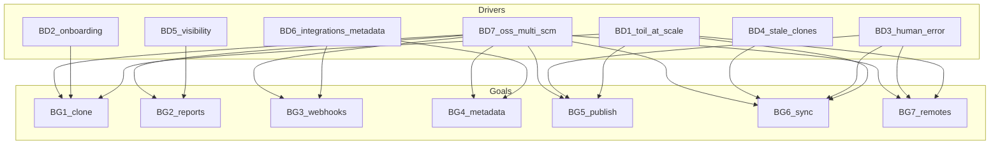

# Бизнес-цели Git Herder

[Бизнес-цели][BUSINESS-GOAL-TERM] описывают, **чего** продукт должен достичь для
[стейкхолдеров](stakeholders.md). Обоснование «почему» — в
[бизнес-драйверах](drivers.md).

Отбор репозиториев и параметры операций задаются **аргументами CLI** (организация
или группа на SCM, шаблон имени, признаки отбора, поддерживаемые платформой
топики/теги, целевой каталог для локальных копий). Сохраняемые профили отбора —
возможное расширение без смены смысла целей ниже.

## Допущения продукта (границы для измерения)

| Тема | Допущение |
| ---- | --------- |
| Публикация в SCM | Поддерживаются сценарии создания репозитория на SCM через API до первого push и push в уже существующие репозитории; для связанных изменений — согласованные имена веток в наборе копий |
| Отчёты | Человекочитаемый вывод (таблица, CSV) и машиночитаемый JSON для автоматизации |
| Массовый pull/fetch | Best-effort по репозиториям с отчётом по каждой копии; итоговый статус отражает наличие ошибок (в т.ч. конфликтов) |
| Секреты и код | См. [README.md](../README.md#вне-области-продукта) |

## Соответствие MVP

Первая поставка открытого продукта фокусируется на целях **BG-1**, **BG-2**, **BG-5**,
**BG-6** для [SCM-платформ][SCM-PLATFORM-TERM] **GitLab** и **GitHub**. Цели **BG-3**,
**BG-4**, **BG-7** и расширение платформ — в замысле продукта, реализация после MVP.

| Цель | MVP |
| ---- | --- |
| BG-1 | Да |
| BG-2 | Да |
| BG-3 | Нет |
| BG-4 | Нет |
| BG-5 | Да |
| BG-6 | Да |
| BG-7 | Нет |

## Паритет SCM-платформ {#паритет-scm-платформ}

Единый замысел целей BG-1–BG-7 не дублируется отдельной целью на каждую платформу.
Расширение поддержки идёт по фазам:

| Фаза | Платформы | Цели |
| ---- | --------- | ---- |
| MVP | GitLab, GitHub | BG-1, BG-2, BG-5, BG-6 |
| После MVP | Bitbucket | BG-1–BG-7 по мере реализации capability |
| После MVP | GitVerse | BG-1–BG-7 по мере реализации capability |

Драйвер [BD-7](drivers.md#bd-7) обосновывает мультиплатформенность для OSS.

## Реестр целей

### BG-1 {#bg-1}

**Массовое клонирование.** Сократить время и усилия на получение согласованного
набора рабочих копий по отбору из SCM в заданный каталог.

**Как измерять:** сравнение длительности и числа ручных команд (`git clone`, переход
между репозиториями) с одним запуском CLI; для онбординга — время от старта до
первого коммита во всём целевом наборе репозиториев (опрос или фиксация в команде).

**Стейкхолдеры:** [ST-1](stakeholders.md#st-1), [ST-2](stakeholders.md#st-2).

**Драйверы:** [BD-1](drivers.md#bd-1), [BD-2](drivers.md#bd-2), [BD-7](drivers.md#bd-7).

**MVP:** да (GitLab, GitHub).

### BG-2 {#bg-2}

**Отчёты по репозиториям на SCM.** Дать возможность быстро получать ответы о
состоянии множества репозиториев (наличие ветки, расхождение между ветками и
аналогичные запросы) без поочерёдного обхода UI SCM.

**Как измерять:** время выполнения типовых запросов (например, «все репозитории с
веткой `feature/foo-bar`», «репозитории с отличием `test` от `master`»); число
репозиториев, покрытых одним запуском.

**Стейкхолдеры:** [ST-1](stakeholders.md#st-1), [ST-2](stakeholders.md#st-2).

**Драйверы:** [BD-5](drivers.md#bd-5), [BD-7](drivers.md#bd-7).

**MVP:** да (GitLab, GitHub).

### BG-3 {#bg-3}

**Управление вебхуками.** Снизить трудозатраты и риск ошибок при массовом
создании, изменении и удалении вебхуков репозиториев для интеграций (например, с
таск-трекером).

**Как измерять:** число репозиториев, обработанных за один прогон; число ручных
исправлений или инцидентов интеграции после массовой настройки (ретроспектива).

**Стейкхолдеры:** [ST-2](stakeholders.md#st-2).

**Драйверы:** [BD-6](drivers.md#bd-6), [BD-7](drivers.md#bd-7).

**MVP:** нет.

### BG-4 {#bg-4}

**Теги, топики, описания на SCM.** Обеспечить единообразие метаданных репозиториев
на платформе для фильтрации и управления при большом числе репозиториев.

**Как измерять:** доля репозиториев в наборе, приведённых к целевой схеме
метаданных; время массового обновления относительно ручного обхода.

**Стейкхолдеры:** [ST-2](stakeholders.md#st-2).

**Драйверы:** [BD-6](drivers.md#bd-6), [BD-7](drivers.md#bd-7).

**MVP:** нет.

### BG-5 {#bg-5}

**Публикация рабочих копий в SCM.** Сократить время и риск ошибок при создании
репозиториев на SCM (при необходимости) и отправке изменений из нескольких
локальных рабочих копий, в том числе при связанных изменениях в одном наборе
веток.

**Как измерять:** число пропущенных репозиториев или push в сценарии
мультирепозиторной поставки; время полного цикла публикации набора относительно
ручного обхода копий.

**Стейкхолдеры:** [ST-1](stakeholders.md#st-1).

**Драйверы:** [BD-1](drivers.md#bd-1), [BD-3](drivers.md#bd-3), [BD-7](drivers.md#bd-7).

**MVP:** да (GitLab, GitHub).

### BG-6 {#bg-6}

**Массовое обновление локальных копий.** Повысить актуальность клонов набора
(`git pull` / `git fetch`) без ручного обхода каждой рабочей копии.

**Как измерять:** частота полного обновления набора (до/после внедрения практики
с CLI); число дефектов или конфликтов, связанных с устаревшим кодом (опрос,
ретроспектива команды).

**Стейкхолдеры:** [ST-1](stakeholders.md#st-1).

**Драйверы:** [BD-1](drivers.md#bd-1), [BD-3](drivers.md#bd-3), [BD-4](drivers.md#bd-4), [BD-7](drivers.md#bd-7).

**MVP:** да (GitLab, GitHub).

### BG-7 {#bg-7}

**Управление remote у набора копий.** Снизить время и ошибки при добавлении,
изменении и удалении remote у множества локальных рабочих копий.

**Как измерять:** время операции на N копий относительно N ручных вызовов
`git remote`; число расхождений URL remote с эталоном после массовой операции.

**Стейкхолдеры:** [ST-1](stakeholders.md#st-1).

**Драйверы:** [BD-1](drivers.md#bd-1), [BD-3](drivers.md#bd-3), [BD-7](drivers.md#bd-7).

**MVP:** нет.

## Связь целей и драйверов

<!-- LINKS -->

[BUSINESS-GOAL-TERM]: ../../../glossary/terms/business-goal.md
[SCM-PLATFORM-TERM]: ../../../glossary/terms/scm-platform.md
