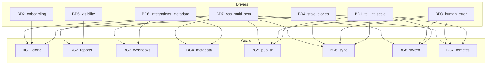

# Бизнес-цели Git Herder

[Бизнес-цели][BUSINESS-GOAL-TERM] описывают, **чего** продукт должен достичь для
[стейкхолдеров](stakeholders.md). Обоснование «почему» — в
[бизнес-драйверах](drivers.md).

Отбор репозиториев и параметры операций задаются **аргументами CLI** (организация
или группа на [SCM][SCM-PLATFORM-TERM], шаблон имени, признаки отбора, поддерживаемые
платформой топики/теги, целевой каталог для локальных копий). Типовые значения и
подключение к SCM — в [профилях Git Herder](../capability/platform/profiles.md) (P0-enabler);
аргументы вызова могут переопределять дефолты профиля (детали — в спецификации).

## Допущения продукта (границы для измерения)

| Тема | Допущение |
| ---- | --------- |
| Публикация в SCM | Поддерживаются сценарии создания репозитория на SCM через API до первого push и push в уже существующие репозитории; для связанных изменений — согласованные имена веток в наборе копий |
| Отчёты | Человекочитаемый вывод (таблица, CSV) и машиночитаемый JSON для автоматизации; capability — [отчёт о репозиториях в SCM](../capability/scm/scm-repository-reports.md) |
| Массовый pull/fetch | Best-effort по репозиториям с отчётом по каждой копии; итоговый статус отражает наличие ошибок (в т.ч. конфликтов) |
| Массовый switch веток | Одна целевая ветка (или согласованное правило имени) на набор копий; best-effort с отчётом по каждой копии; создание локальной ветки при отсутствии — по явному флагу CLI |
| Массовое клонирование | Настраиваемая политика при ошибке на одном репозитории (best-effort vs прервать операцию); детали — [массовое клонирование](../capability/scm/mass-clone.md) |
| Секреты и код | См. [README.md](../README.md#вне-области-продукта) |

## Паритет SCM-платформ {#паритет-scm-платформ}

Единый замысел целей BG-1–BG-8 не дублируется отдельной целью на каждую платформу.
Расширение поддержки идёт по фазам:

| Фаза | Платформы | Цели |
| ---- | --------- | ---- |
| P0 | GitLab, GitHub | BG-1, BG-2, BG-5, BG-6, BG-8 |
| P1+ | Bitbucket | BG-1–BG-8 по мере реализации capability |
| P1+ | GitVerse | BG-1–BG-8 по мере реализации capability |

Драйвер [BD-7](drivers.md#bd-7) обосновывает мультиплатформенность для OSS.

## Реестр целей

**P0** — первая поставка (MVP). **P1** — следующая очередь после P0.

### BG-1 {#bg-1}

**Приоритет:** P0 (GitLab, GitHub).

**Массовое клонирование.** Сократить время и усилия на получение согласованного
набора рабочих копий по отбору из SCM в заданный каталог. Capability:
[массовое клонирование из SCM](../capability/scm/mass-clone.md).

**Как измерять:** сравнение длительности и числа ручных команд (`git clone`, переход
между репозиториями) с одним запуском CLI; для онбординга — время от старта до
первого коммита во всём целевом наборе репозиториев (опрос или фиксация в команде).

**Стейкхолдеры:** [ST-1](stakeholders.md#st-1), [ST-2](stakeholders.md#st-2).

**Драйверы:** [BD-1](drivers.md#bd-1), [BD-2](drivers.md#bd-2), [BD-7](drivers.md#bd-7).

### BG-2 {#bg-2}

**Приоритет:** P0 (GitLab, GitHub).

**Отчёты по репозиториям на SCM.** Дать возможность быстро получать ответы о
состоянии множества репозиториев (наличие ветки, расхождение между ветками и
аналогичные запросы) без поочерёдного обхода UI SCM. Capability:
[отчёт о репозиториях в SCM](../capability/scm/scm-repository-reports.md).

**Как измерять:** время выполнения типовых запросов (например, «все репозитории с
веткой `feature/foo-bar`», «репозитории с отличием `test` от `master`»); число
репозиториев, покрытых одним запуском.

**Стейкхолдеры:** [ST-1](stakeholders.md#st-1), [ST-2](stakeholders.md#st-2).

**Драйверы:** [BD-5](drivers.md#bd-5), [BD-7](drivers.md#bd-7).

### BG-3 {#bg-3}

**Приоритет:** P1.

**Управление вебхуками.** Снизить трудозатраты и риск ошибок при массовом
создании, изменении и удалении вебхуков репозиториев для интеграций (например, с
таск-трекером).

**Как измерять:** число репозиториев, обработанных за один прогон; число ручных
исправлений или инцидентов интеграции после массовой настройки (ретроспектива).

**Стейкхолдеры:** [ST-2](stakeholders.md#st-2).

**Драйверы:** [BD-6](drivers.md#bd-6), [BD-7](drivers.md#bd-7).

### BG-4 {#bg-4}

**Приоритет:** P1.

**Теги, топики, описания на SCM.** Обеспечить единообразие метаданных репозиториев
на платформе для фильтрации и управления при большом числе репозиториев.
Capability:
[редактирование метаданных репозиториев на SCM](../capability/scm/scm-repository-metadata.md).

**Как измерять:** доля репозиториев в наборе, приведённых к целевой схеме
метаданных; время массового обновления относительно ручного обхода.

**Стейкхолдеры:** [ST-2](stakeholders.md#st-2).

**Драйверы:** [BD-6](drivers.md#bd-6), [BD-7](drivers.md#bd-7).

### BG-5 {#bg-5}

**Приоритет:** P0 (GitLab, GitHub).

**Публикация рабочих копий в SCM.** Сократить время и риск ошибок при создании
репозиториев на SCM (при необходимости) и отправке изменений из нескольких
локальных рабочих копий, в том числе при связанных изменениях в одном наборе
веток.

**Как измерять:** число пропущенных репозиториев или push в сценарии
мультирепозиторной поставки; время полного цикла публикации набора относительно
ручного обхода копий.

**Стейкхолдеры:** [ST-1](stakeholders.md#st-1).

**Драйверы:** [BD-1](drivers.md#bd-1), [BD-3](drivers.md#bd-3), [BD-7](drivers.md#bd-7).

### BG-6 {#bg-6}

**Приоритет:** P0 (GitLab, GitHub).

**Массовое обновление локальных копий.** Повысить актуальность клонов набора
(`git pull` / `git fetch`) без ручного обхода каждой рабочей копии.

**Как измерять:** частота полного обновления набора (до/после внедрения практики
с CLI); число дефектов или конфликтов, связанных с устаревшим кодом (опрос,
ретроспектива команды).

**Стейкхолдеры:** [ST-1](stakeholders.md#st-1).

**Драйверы:** [BD-1](drivers.md#bd-1), [BD-3](drivers.md#bd-3), [BD-4](drivers.md#bd-4), [BD-7](drivers.md#bd-7).

### BG-8 {#bg-8}

**Приоритет:** P0 (GitLab, GitHub).

**Массовое переключение веток в рабочих копиях.** Сократить время и риск ошибок
при старте работы над фичей, затрагивающей несколько репозиториев: перейти на
нужную ветку (`git switch` / checkout) во всём наборе локальных копий без
ручного обхода каждого репозитория.

**Как измерять:** время подготовки набора копий к работе над фичей (N ручных
`git switch` vs один запуск CLI); число репозиториев, оставшихся на неверной
ветке после начала работы (опрос, ретроспектива).

**Стейкхолдеры:** [ST-1](stakeholders.md#st-1).

**Драйверы:** [BD-1](drivers.md#bd-1), [BD-3](drivers.md#bd-3), [BD-7](drivers.md#bd-7).

### BG-7 {#bg-7}

**Приоритет:** P1.

**Управление remote у набора копий.** Снизить время и ошибки при добавлении,
изменении и удалении remote у множества локальных рабочих копий.

**Как измерять:** время операции на N копий относительно N ручных вызовов
`git remote`; число расхождений URL remote с эталоном после массовой операции.

**Стейкхолдеры:** [ST-1](stakeholders.md#st-1).

**Драйверы:** [BD-1](drivers.md#bd-1), [BD-3](drivers.md#bd-3), [BD-7](drivers.md#bd-7).

## Связь целей и драйверов

<!-- LINKS -->

[BUSINESS-GOAL-TERM]: ../../../glossary/terms/business-goal.md
[SCM-PLATFORM-TERM]: ../../../glossary/terms/scm-platform.md
